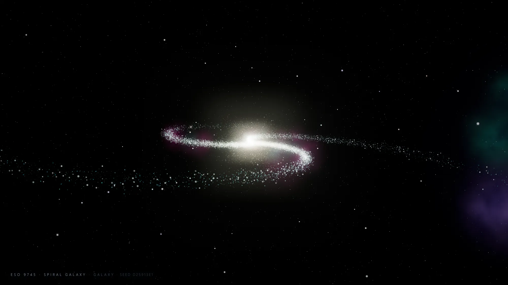
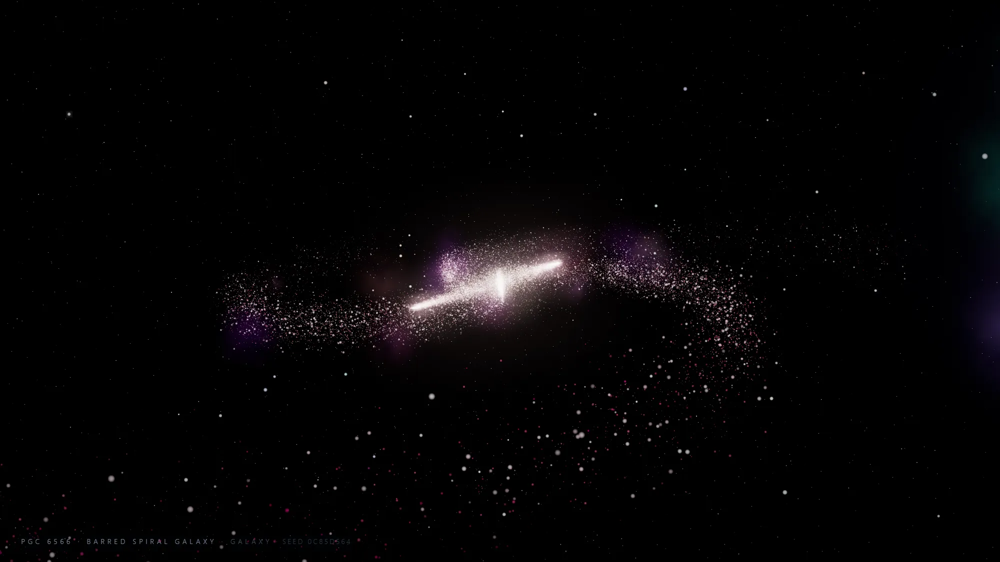
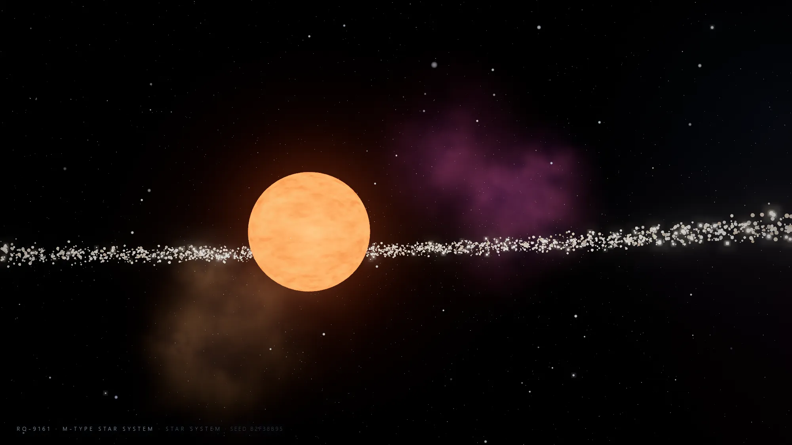
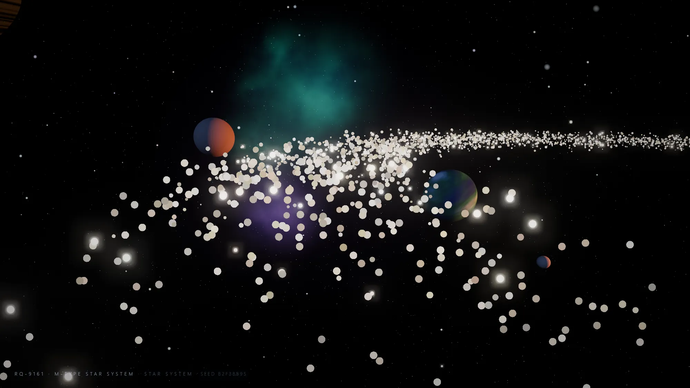
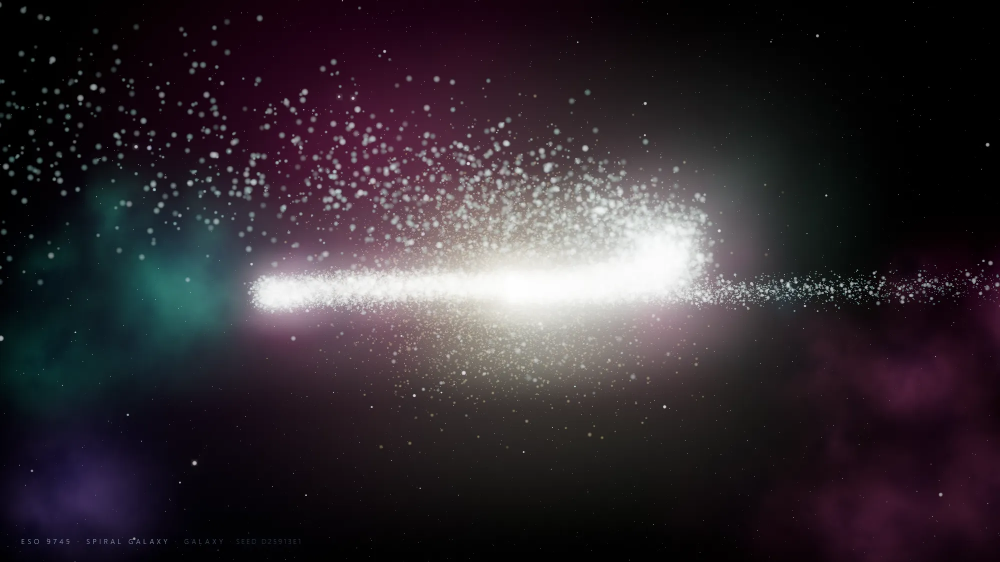

# 3js-universe

An endless, procedurally generated fly-through of galaxies and star systems,
built with [three.js](https://threejs.org/). The camera drifts through a newly
generated world, the view fades to black, another world is generated, and it
starts again — forever, with no two scenes alike.

No spaceship, no HUD clutter, no UI chrome: the point is the view.



## What it does

- **Always something new.** Every scene is generated from a fresh 32-bit seed
  and thrown away when the camera leaves it, so variety never runs out and
  memory never grows. Reload and you get a different universe; pass `?seed=` to
  reproduce one exactly.
- **Six kinds of galaxy.** Spiral, barred spiral, grand-design pinwheel, ring,
  elliptical and irregular, each built from tens of thousands of additively
  blended dust motes: a dense warm nucleus, logarithmic arms tinted blue, pink
  or violet, young hot stars, in-disc nebulae, and a glow that steps back as
  the camera drops into the core.
- **Star systems with real worlds.** A star of a random spectral class (M…O)
  with a granulated photosphere, layered corona and a point light that shades
  what orbits it. One to five worlds — lava, desert, terran, ocean, gas or ice —
  each with a procedurally painted surface (plus emissive lava maps), and often
  an atmospheric rim, a ring system or moons. A debris belt cuts across the
  frame. Planets orbit, spin and show a terminator as you pass.
- **A permanent deep sky.** Distant star field, coloured nebula banks and
  drifting near dust that follow the observer, so the horizon can never run out
  across infinite scene changes.
- **Calm motion.** The flight is authored as a smooth sweep with even pacing and
  a dwell through the pivot, so the camera turns at most ~15°/s where it leans
  around a galactic core or a star.

## Screenshots

| | |
| --- | --- |
|  |  |
| A barred spiral, bar and arms intact | Skimming the star, belt and nebulae sweeping past |
|  |  |
| Passing worlds inside a debris belt | The bright, crowded heart of a spiral |

Every frame above is the app running — there is no post-production.

Shot list, for reproducing them: `?kind=galaxy&seed=9`, `?kind=galaxy&seed=31`,
`?kind=system&seed=7`.

## Quick start

Requires Node 20.19+ or 22.12+ (Vite 7) and a browser with WebGL 2.

```bash
git clone https://github.com/sivartydrup/3js-universe.git
cd 3js-universe
npm install
npm run dev            # http://localhost:5173
```

Then open the URL and leave it running — it flies itself.

Other scripts:

```bash
npm run build          # static bundle in dist/
npm run preview        # serve the built bundle
```

`dist/` is a plain static folder: any file server or static host will do.

## Controls

Almost nothing to do — but if you want to steer:

| Input | Effect |
| --- | --- |
| `N` | skip to the next world now |
| `?seed=<number or text>` | reproduce a specific sequence of worlds |
| `?kind=galaxy` / `?kind=system` | force what gets generated |

The small caption in the corner names the current world and shows its seed,
so anything you like can be revisited.

## How it works

### Worlds

`galaxy.js` and `starSystem.js` each turn a seed into geometry:

- **Galaxies** sample an exponential disc with a gaussian bulge, then place each
  mote on a logarithmic arm (or a bar, a ring, or a clump, depending on type),
  colouring it from a warm nucleus palette toward hot arm stars by radius.
- **Star systems** pick a spectral class, paint planet surfaces on a canvas from
  seeded value-noise (bands for gas giants, continents and ice caps for rocky
  worlds, glowing cracks for lava worlds), and assemble orbits, rings, moons,
  atmospheres and a debris belt. A `PointLight` at the star does the shading.
- Both add a handful of wispy nebula sprites for colour, using soft additive
  sprites generated at runtime.

### Flight

A world's flight is a **polar sweep**: one monotone pass in azimuth with a
radius profile interpolated through keyframes (monotone cubic, so the profile
can never bulge past the keys it was given).

That shape is deliberate. Authoring a turnaround as a single waypoint ("fly in,
turn, fly out") puts the whole direction change inside one short spline
segment, and the camera reads as if it bounced off an invisible wall. Written as
a radius profile, the same turn is a *lean* in the curve, spread over the
azimuth the shape has available.

Supporting pieces:

- **Curvature-selected routes** — galaxies try several profiles; star systems
  try every visit set (which worlds to graze) in both sweep directions. Each
  candidate is scored by the sharpest curvature of the curve *as flown*, and the
  calmest one wins.
- **Dwell** — path progress is warped to linger through the middle of the
  flight, where the pivot is, and glide in and out a little quicker.
- **Arc-length conditioning** — the final waypoints are re-spaced evenly along
  the curve's own arc length. Shape and timing are unchanged; the spline simply
  no longer has a short segment next to a long one, which is where a Catmull-Rom
  starts to curl.
- **Even pacing** — a world's duration is derived from its path length at a
  fixed cruising speed (~30 units/s), so a sprawling system gets more time
  rather than being flown at a much higher turn rate. Turn rate ≈ speed ÷
  curvature radius, so pacing *is* smoothness.
- **Flyby aiming** — worlds keep orbiting while a scene plays, so the generator
  solves for when each waypoint is actually reached (inverting the easing), aims
  the pass at where that world *will be*, rides its orbital plane so the camera
  doesn't cross far above or below it, and approaches on the sunward side so you
  see a lit face rather than a silhouette.
- **Clearance** — a final pass guarantees every waypoint clears every body, and
  an eased (never snapping) safety push covers everything else, alongside a
  damped look-at, a slow roll and sub-unit positional drift.

### The endless loop

`director.js` owns a simple timeline per world: fade in (4.2 s), fly, fade out
(3.6 s). Once the screen is more than half faded to black it generates the
successor — hiding the build cost behind the fade — warms its shaders with
`compileAsync`, and at full black swaps worlds and disposes every GPU resource
the previous one owned. Nothing is reused between worlds.

### Rendering

`WebGLRenderer` with ACES tone mapping → `EffectComposer` (4× MSAA half-float
target when the device supports it) → `UnrealBloomPass` → `OutputPass` → a final
grade pass adding the fade to black, a vignette and a whisper of dither to keep
gradients smooth.

## Tech

- [three.js](https://threejs.org/) r180 — WebGL renderer, post-processing
- [Vite](https://vite.dev/) 7 — dev server and bundle
- No other runtime dependencies. Textures and sprites are generated on canvas at
  runtime; there are no image assets to download.

## Project layout

```
index.html         page shell, HUD caption
src/
  main.js          renderer, composer, loop, HUD, resize
  director.js      endless world lifecycle, camera flight, fades, disposal
  timing.js        shared fade/path timing, dwell warp, pacing
  paths.js         polar-sweep path building, curvature metrics, clearance
  galaxy.js        galaxy generator
  starSystem.js    star system generator
  backdrop.js      permanent deep sky, nebulae and near dust
  points.js        point-cloud shader material + pixel scale registry
  textures.js      canvas-generated sprites, planet/star/ring surfaces
  rng.js           seedable PRNG
```

## Performance notes

Built for a steady 60 fps on a discrete GPU: ~60–90k points per galaxy in a
single draw call, one shared sphere geometry for every round body, and no
per-frame CPU work beyond camera maths and the handful of animated orbits.

Measured in a *headless software* renderer (SwiftShader, no GPU), the whole
pipeline runs ~38 fps at 1600×900 with 4× MSAA, so real hardware has plenty of
headroom. The pixel ratio is capped at 2 and `dt` is clamped, so a slow tab
slows the camera rather than jumping it.

## License

[Apache-2.0](LICENSE) — see the LICENSE file for details.
